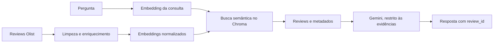

# Voice of Customer | Olist

Assistente de análise qualitativa de avaliações do Brazilian E-Commerce Public Dataset by Olist.
O usuário faz uma pergunta em linguagem natural; o sistema busca reviews relacionados e gera uma
resposta com referências às avaliações que serviram de evidência.

## Valor para o negócio

O projeto reduz o esforço de explorar manualmente milhares de comentários e ajuda a identificar
temas relatados pelos clientes, como defeitos, atrasos e experiências positivas. As respostas são
qualitativas: a busca por similaridade não equivale a uma contagem estatística e não deve ser usada,
sozinha, para afirmar frequência ou causalidade.

## Como funciona



O índice usa a coleção `avaliacoes_olist`, distância cosine e o modelo
`paraphrase-multilingual-MiniLM-L12-v2`. Detalhes da arquitetura e das decisões técnicas estão em
[docs/architecture.md](docs/architecture.md); regras de seleção, limpeza, metadados e indexação
estão em [docs/data-preparation.md](docs/data-preparation.md).

## Executar

O passo a passo reproduzível — ambiente virtual, dependências, chave Gemini, download dos dados,
geração do índice de amostra e execução da aplicação — está em
[docs/getting-started.md](docs/getting-started.md).

## Estado e limitações conhecidos

- Validado localmente com índice de amostra de 2.000 reviews: busca semântica, filtros Chroma e
  uma chamada real ao Gemini com citações correspondentes aos reviews recuperados.
- Os testes automatizados usam doubles para os serviços externos e não consomem a API Gemini.
- A abstinência atual ocorre quando a busca retorna zero resultados. Ainda não há limiar calibrado
  para rejeitar resultados semanticamente fracos.
- O smoke test não substitui a avaliação estruturada da bateria de perguntas nem a validação do
  índice completo. Não use a amostra para tirar conclusões quantitativas sobre todos os clientes.
- Dados, índices, credenciais e configurações locais não fazem parte do repositório.

## Estrutura do repositório

```text
.
├── app.py                       # Interface Streamlit
├── docs/                        # Guias, arquitetura e preparação dos dados
├── notebooks/                   # Exploração e experimentos de busca
├── src/
│   ├── baixar_dados.py           # Download das tabelas Olist
│   ├── indexar_base.py           # Construção do índice Chroma
│   ├── preparar_base.py          # Limpeza e enriquecimento dos reviews
│   └── voice_of_customer/        # Recuperação, pipeline, Gemini e modelos
├── tests/                       # Testes automatizados
├── .env.example                  # Modelo de configuração local, sem segredos
└── pyproject.toml                # Dependências e configuração do pacote
```

`requirements.txt` é um atalho de instalação que aponta para os extras definidos no `pyproject.toml`.

## Segurança e dados

Configure a chave apenas no `.env` local. Não a inclua em commits, logs ou capturas de tela.
Os dados brutos e o índice são recriados localmente pelos comandos documentados no guia de
instalação e não são versionados.
